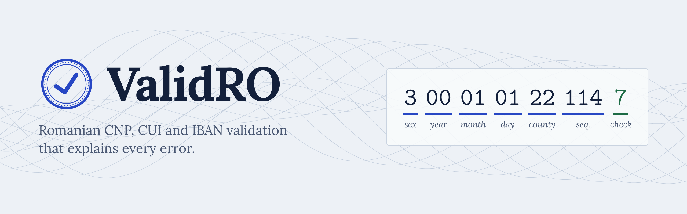

<p align="center">
  
</p>

<p align="center">
  <a href="https://github.com/Robert-GeorgeDev/ValidRO/actions/workflows/ci.yml"></a>
  <a href="https://www.npmjs.com/package/validro"></a>
  <a href="https://bundlephobia.com/package/validro"></a>
  
  <a href="LICENSE"></a>
</p>

<p align="center">
  <a href="https://robert-georgedev.github.io/ValidRO/"><strong>Try it in your browser</strong></a>
</p>

Validate and decode Romanian identifiers (**CNP**, **CUI/CIF** and **IBAN**) with error messages you can show directly to users. Zero dependencies, fully typed, runs in Node and in the browser.

```bash
npm install validro
```

## Why ValidRO

- **Current rules.** Accepts county code `70`, which the civil-status system (SIIEASC) now assigns to newly generated CNPs. Many older validators reject these valid codes.
- **Explains the error.** Messages are in Romanian and say what is wrong: `Cifra de control este greșită (așteptat 7)`.
- **Decodes, not just validates.** Sex, birth date, county, bank code.
- **Private.** Everything runs locally. Nothing is sent anywhere.

## Usage

```ts
import { validateCnp, validateCui, validateIbanRo } from "validro";

validateCnp("3000101221147");
// {
//   valid: true,
//   error: null,
//   data: { cnp: "3000101221147", sex: "M", birthDate: "1800-01-01",
//           countyCode: "22", county: "Iași", foreigner: false }
// }

validateCnp("3000101221148");
// { valid: false, error: "Cifra de control este greșită (așteptat 7)", data: null }

validateCui("RO12345674");
// { valid: true, error: null, data: { cui: "12345674", hasRoPrefix: true } }

validateIbanRo("ro49 aaaa 1b31 0075 9384 0000");
// { valid: true, error: null,
//   data: { iban: "RO49AAAA1B31007593840000", formatted: "RO49 AAAA 1B31 0075 9384 0000",
//           bankCode: "AAAA", treasury: false } }
```

Every `validate*` function returns the same shape, so you can handle all of them the same way:

```ts
type ValidationResult<T> =
  | { valid: true; error: null; data: T }
  | { valid: false; error: string; data: null };
```

Only need true or false? Use `isValidCnp`, `isValidCui` and `isValidIbanRo`.

## API

| Function | Returns |
| --- | --- |
| `validateCnp(cnp, now?)` | `ValidationResult<CnpInfo>`; `now` sets the date used to reject future birth dates |
| `validateCui(cui)` | `ValidationResult<CuiInfo>` |
| `validateIbanRo(iban)` | `ValidationResult<IbanInfo>` |
| `isValidCnp`, `isValidCui`, `isValidIbanRo` | `boolean` |
| `cnpControlDigit(first12)` | the CNP control digit |
| `cuiControlDigit(body)` | the CUI control digit |
| `ibanChecksumOk(iban)` | mod-97 check, works for any country |
| `CNP_COUNTIES` | county codes and names |

## What is checked

| Identifier | Checks |
| --- | --- |
| CNP | 13 digits, sex and century digit, real calendar date including leap years, not in the future, county code (01–52, 70), sequence not 000, control digit (key `279146358279`) |
| CUI / CIF | optional `RO` prefix, 2–10 digits, no leading zero, control digit (key `753217532`) |
| IBAN (RO) | 24 characters: `RO`, 2 check digits, 4-letter bank code, 16 alphanumerics, ISO 13616 mod-97 |

Spaces, dots and dashes in the input are ignored.

## Limits

A valid code is **well-formed**; it does not prove the code **exists**. A valid CNP may belong to no one, and a valid CUI may be a closed company. To confirm a company is active, query the public ANAF services.

For residents and foreigners (CNP starting with 7, 8 or 9) the century is not encoded, so ValidRO picks the most recent century that does not put the birth date in the future.

## Privacy

ValidRO never makes network requests. The demo page runs the same code in your browser.

All examples in this repository are fictitious: sample CNPs use birth dates in the 1800s, and the IBAN is the official example from the ISO 13616 registry. Please never paste real personal data into issues or tests.

## Roadmap

- [ ] Romanian licence plates
- [ ] Phone numbers, normalized to `+40`
- [ ] Postal codes
- [ ] Python port

Ideas and bugs are welcome in [issues](https://github.com/Robert-GeorgeDev/ValidRO/issues). See [CONTRIBUTING.md](CONTRIBUTING.md) to get started.

## License

[MIT](LICENSE)
